<!-- Generated by scripts/build.mjs from scripts/readme.template.md and the live studio site. Edit the template, not this file. -->

I'm Nathan Nixon, and Nixon Creative Studio is me: one person in Cincinnati who designs the site, builds it and, when it's needed, shoots the photos and film for it. I work with churches, schools, nonprofits and small businesses, and I take on a handful of new builds a year so each one gets my full attention.

## Nine selected case studies

Each card opens its case study on [the studio site](https://nixoncreativestudio.com/work/).

The same nine in words, with the live sites and the code

 

- **[Stone Steps 50K](https://nixoncreativestudio.com/work/stone-steps-50k/)** (nonprofit). Twenty-four years of results that update themselves after each race, so the race director stops keeping them by hand and every runner has a page. [stonesteps50k.com](https://stonesteps50k.com) · [code](https://github.com/NateJ45/stonesteps-50k)
- **[MAS Monograms](https://nixoncreativestudio.com/work/mas-monograms/)** (small business). A Squarespace site rebuilt as a custom site that can move if it ever needs to, where customers design a monogram before they ask for a price. [mas-monograms.com](https://mas-monograms.com) · [code](https://github.com/NateJ45/mas-monograms)
- **[The Presbyterian Academy](https://nixoncreativestudio.com/work/presbyterian-academy/)** (school). A new school with a front door that reads like its own catalog: clear courses, the people teaching them and an easy first step. [presbyterianacademy.org](https://presbyterianacademy.org) · [code](https://github.com/NateJ45/presacademy)
- **[Theology Matters](https://nixoncreativestudio.com/work/theology-matters/)** (nonprofit). Thirty years of the journal online and searchable, audio on every essay, editing screens the staff run on their own, and sign-ups that reach their mailing list. [theologymatters.com](https://theologymatters.com)
- **[First Baptist Church Muncie](https://nixoncreativestudio.com/work/first-baptist-muncie/)** (church). The church's pages, posts and photos in one place the staff can edit, live on fbcmuncie.org since October 2026. [fbcmuncie.org](https://fbcmuncie.org) · [code](https://github.com/NateJ45/fbcm)
- **[Reid Design](https://nixoncreativestudio.com/work/reid-design/)** (small business). Shows how Staci works and what it costs, so a visitor arrives at the first call already knowing the plan. [reiddesignllc.com](https://reiddesignllc.com) · [code](https://github.com/NateJ45/reid-design-site)
- **[Foundation for Reformed Theology](https://nixoncreativestudio.com/work/foundation-for-reformed-theology/)** (nonprofit). A library ministers can search down to the full text, recordings with transcripts, and editing screens the staff keep current without a developer. [foundationrt.org](https://foundationrt.org)
- **[First Presbyterian Church of Orangeburg](https://nixoncreativestudio.com/work/first-presbyterian-orangeburg/)** (church). Worship, ministry, giving, and building reservations organized for visitors and members alike. [1stpresbyterian.org](https://1stpresbyterian.org)
- **[West Chester Preschool](https://nixoncreativestudio.com/work/west-chester-preschool/)** (school). Classes filled to 41 of 43 places, up from 26 students, website visits up 738% in enrollment season, and a store that has sold $2,544.64. [westchesterpreschool.org](https://westchesterpreschool.org)

Most of these stand on the [**NCS Astro + Sanity Starter**](https://github.com/NateJ45/ncs-astro-sanity-starter): page-builder-first, live draft preview with click-to-edit on the page, a one-command brand reskin, and a registry of port cards that carries each fix from one site to the rest. The studio site itself is [here](https://github.com/NateJ45/nixoncreativestudio).

## What changed

Counted by the clients, and sourced in each case study.

## In their words

> Nathan Nixon transformed our website from a slow, clunky station wagon to a fast, beautiful sports car. Without compromising the integrity of our message, he's made it more attractive. Exceedingly competent and easy to work with, he has helped enormously to advance our mission.
>
> **Richard E. Burnett, Ph.D.**, Executive Director and Managing Editor, [Theology Matters](https://nixoncreativestudio.com/work/theology-matters/)

Written in 2025 about my earlier work on the site. They came back for a rebuild in 2026.

## From the journal

- [How I built a rota that fills its own gaps for my church's AV team](https://nixoncreativestudio.com/journal/church-av-rota-that-fills-its-own-gaps/) Built in the lab · 8 min
- [Google Ad Grants: does your nonprofit website qualify?](https://nixoncreativestudio.com/journal/google-ad-grants-does-your-nonprofit-website-qualify/) Nonprofits · 8 min
- [How I check every client site every 15 minutes](https://nixoncreativestudio.com/journal/how-i-check-every-client-site/) Built in the lab · 6 min
- [How much does a church website cost in 2026?](https://nixoncreativestudio.com/journal/how-much-does-a-church-website-cost/) Costs · 8 min
- [How do I get my church to show up in ChatGPT and Google AI answers?](https://nixoncreativestudio.com/journal/how-to-show-up-in-chatgpt-and-google-ai-answers/) Churches · 7 min

[All the posts](https://nixoncreativestudio.com/journal/)

## Behind the camera too

I shoot the photos and short films that go on these sites: portraits, buildings and people at work, on a Canon R6 Mark II with off-camera lighting. The [photography page](https://nixoncreativestudio.com/photography/) has the whole wall.

## How I work

- **Every site meets the same bar.** Playwright smoke, axe and reflow tests on Chromium and WebKit iPhone, a Lighthouse gate, visual regression, prettier, type checks and link checks, with `main` protected behind PR plus green CI.
- **Fixes travel.** A lesson learned on one client site gets a port card in the starter, then rolls out to the rest, and `sync-check` catches drift.
- **Backups are boring and automatic.** Encrypted weekly Sanity exports to GitHub artifacts and R2, with a retention policy.
- **Docs are part of done.** Every repo carries a CLAUDE.md, a runbook and a dated decisions log, so the next session (mine, an agent's or a collaborator's) starts informed.
- **I measure before I fix.** The Stone Steps LCP work blamed the stylesheet for a week until blocking one resource class at a time found the real cause in an hour.
- **AI-assisted, human-reviewed.** I delegate scoped implementation to coding agents, then review, verify and integrate myself.

## Tech

| Area | Tools |
|---|---|
| **Front end** | Astro 7, React 19 islands, Tailwind 4, shadcn/ui, view transitions, scroll-driven motion, accessible and responsive by default |
| **Content** | Sanity v6 (embedded Studio, live preview, click-to-edit), EmDash CMS, WordPress with Bricks, ACF and RankMath, Squarespace (native blocks plus custom CSS) |
| **Edge and data** | Cloudflare Workers, D1, R2, Email Sending, Turnstile, DNS, WAF and cache rules, Stripe Payment Links, Resend |
| **Quality** | Playwright (Chromium and WebKit), axe, Lighthouse CI, visual regression, prettier, protected branches and required checks |
| **Automation** | GitHub Actions (nightly imports, encrypted backups, uptime checks), Node scripts, Google Apps Script, Claude Code agents |

## Elsewhere

The first conversation is free and ends with an honest ballpark. I read every message myself and reply within one or two business days.

This page draws itself from <a href="https://nixoncreativestudio.com/">nixoncreativestudio.com</a>: the cards, colours, results and journal links come from the live site and are redrawn every week by <a href="scripts/build.mjs">a small script</a>.

